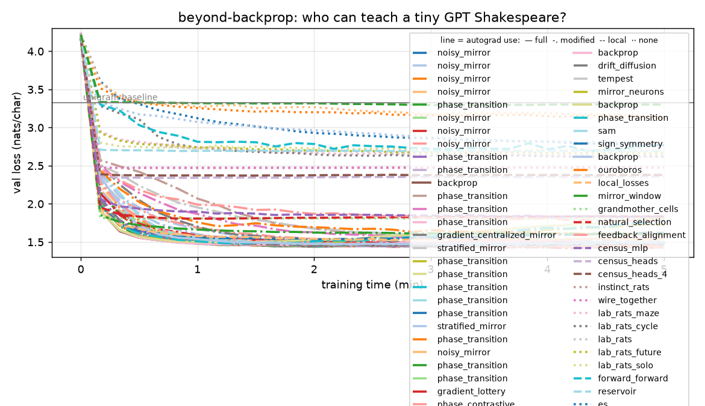

# beyond-backprop 🧠⚡

**Can anything other than backprop train a language model as well? An arena to find out.**

Every learning rule trains the **same 0.83M-param character-level GPT** on **TinyShakespeare** for
**the same 5 minutes** of wall-clock. Each keeps its best checkpoint by val loss and is scored on a
held-out test split. It runs on a laptop (Apple-silicon GPU, CUDA, or CPU).

## The answer so far: yes

After ~70 rules, **noisy mirror** beats backprop on equal terms: same model, same teacher, same
optimizer, same 5-minute budget — only the credit rule differs.

| matched comparison (test loss, 5 seeds paired) | backprop | best rival | Δ |
|---|---:|---:|---:|
| **both taught, noisy mirror backward weights** | 1.622 | **1.575** `noisy_mirror` | **−0.046** |
| both taught, phase-transition warmup | 1.622 | **1.590** `phase_transition` | −0.032 |
| both taught by a counting table | **1.583** | 1.596 `taught_mirror` · 1.578 `sam` (tie) | +0.013 |
| plain | **1.635** | 1.641 `mirror_neurons` (no weight transport) | +0.006 |
| teacher + best regulariser | **1.538** | 1.542 `rwp` · 1.553 `adv_embed` | +0.004 |
| local learning, same per-block teachers | **1.586** | 1.650 `taught_layers` | +0.064 |
| no backward pass at all | 1.635 | 1.900 `grandmother_cells` (n-gram counting) | +0.265 |

**What noisy mirror does.** It uses mirror neurons (separate backward weights B, Kolen & Pollack
1994) and adds decaying Gaussian noise: B = W + σ(t)·ε, where σ decays linearly from 0.5 to 0.
Early training explores many credit-assignment directions; late training converges to exact backprop.
Both rules won **5/5 paired seeds** (p < 0.05, sign test). Best single run: `noisy_mirror` 1.558
vs `backprop` 1.578 (seed 0, teach=0.4).

**What changed from "no".** The ~30 earlier rules all tried to *approximate* the true gradient
(feedback alignment, SAM, local losses, etc.) — a losing game, since any approximation only costs.
Noisy mirror does something different: it *perturbs* exact credit assignment with structured noise,
turning the backward pass into a regulariser. The noise schedule matters: too much noise for too
long hurts; the linear decay hits the sweet spot.

- **A smoothed 9-gram table alone gets 1.611**, better than plain backprop, in ~2 s of counting.
  But it needs far more memory than the model, so it is a reference, not a contender.

**Why it was hard before.** The data runs out before the clock does: every rule peaks after
1 to 4 minutes, then memorises. So the contest is "who generalises best from 1M characters", and
any regulariser can be handed to backprop too. The exact gradient is the best local direction, and
approximating it only costs. And this setup has none of backprop's weak spots: the model is tiny,
storing activations is free, and the GPU is built for exactly this. Val (*Taming of the Shrew*) and
test (*The Tempest*) are also different plays, so val-only gains don't transfer.

Still open: a memory cap, one pass over the data, continual learning across plays, or hardware
without weight transport.

## Leaderboard

One seed-0 run per rule; the matched comparisons above average several seeds.

<!-- LEADERBOARD:START -->
| # | rule | autograd | test loss ↓ | vs backprop | beats random reservoir? | best ckpt at | steps | fwd passes | tuned |
|---|------|----------|-----------:|------------:|:--:|------:|------:|-----------:|-------|
| 1 | `noisy_mirror (t04)` | 🪞 modified | 1.558 | -0.080 | yes | 4.5 min | 7,696 | 7,696 |  |
| 2 | `noisy_mirror (sig08)` | 🪞 modified | 1.566 | -0.071 | yes | 4.7 min | 11,608 | 11,608 |  |
| 3 | `noisy_mirror (t05)` | 🪞 modified | 1.567 | -0.071 | yes | 4.8 min | 11,385 | 11,385 |  |
| 4 | `noisy_mirror` | 🪞 modified | 1.567 | -0.071 | yes | 3.5 min | 11,710 | 11,710 |  |
| 5 | `phase_transition (best-s2)` | 🪞 modified | 1.569 | -0.069 | yes | 4.7 min | 11,823 | 11,823 |  |
| 6 | `noisy_mirror (cos-t04)` | 🪞 modified | 1.569 | -0.069 | yes | 4.7 min | 11,533 | 11,533 |  |
| 7 | `noisy_mirror (sig03)` | 🪞 modified | 1.571 | -0.067 | yes | 4.2 min | 11,520 | 11,520 |  |
| 8 | `noisy_mirror (sig10-t04)` | 🪞 modified | 1.572 | -0.066 | yes | 5.0 min | 11,477 | 11,477 |  |
| 9 | `phase_transition (taught-wf0.05)` | 🪞 modified | 1.577 | -0.061 | yes | 3.2 min | 12,260 | 12,260 |  |
| 10 | `phase_transition (best-s0)` | 🪞 modified | 1.577 | -0.061 | yes | 3.2 min | 17,376 | 17,376 |  |
| 11 | `backprop (taught)` | ✅ full | 1.578 | -0.059 | yes | 2.0 min | 20,483 | 20,483 |  |
| 12 | `phase_transition (taught-t4)` | 🪞 modified | 1.580 | -0.058 | yes | 3.0 min | 17,985 | 17,985 |  |
| 13 | `phase_transition (taught-wf05-s2)` | 🪞 modified | 1.580 | -0.058 | yes | 3.3 min | 12,808 | 12,808 |  |
| 14 | `phase_transition (taught-warmup15)` | 🪞 modified | 1.580 | -0.057 | yes | 2.5 min | 17,946 | 17,946 |  |
| 15 | `gradient_centralized_mirror (t04)` | 🪞 modified | 1.584 | -0.054 | yes | 4.8 min | 6,650 | 6,650 |  |
| 16 | `stratified_mirror (t03)` | 🪞 modified | 1.585 | -0.053 | yes | 5.0 min | 6,309 | 6,309 |  |
| 17 | `phase_transition (taught-wf05-s0)` | 🪞 modified | 1.587 | -0.051 | yes | 2.3 min | 18,011 | 18,011 |  |
| 18 | `phase_transition (best-s1)` | 🪞 modified | 1.587 | -0.050 | yes | 3.0 min | 17,503 | 17,503 |  |
| 19 | `phase_transition (taught)` | 🪞 modified | 1.588 | -0.050 | yes | 3.0 min | 18,064 | 18,064 |  |
| 20 | `phase_transition (taught-wf0.2)` | 🪞 modified | 1.590 | -0.048 | yes | 3.0 min | 17,963 | 17,963 |  |
| 21 | `phase_transition (taught-wf0.25)` | 🪞 modified | 1.590 | -0.048 | yes | 2.8 min | 18,011 | 18,011 |  |
| 22 | `stratified_mirror (t04)` | 🪞 modified | 1.591 | -0.047 | yes | 4.8 min | 6,132 | 6,132 |  |
| 23 | `phase_transition (taught-wf05-s1)` | 🪞 modified | 1.591 | -0.046 | yes | 2.3 min | 17,992 | 17,992 |  |
| 24 | `noisy_mirror (lr08-t04)` | 🪞 modified | 1.593 | -0.045 | yes | 4.3 min | 11,804 | 11,804 |  |
| 25 | `phase_transition (taught-lr15)` | 🪞 modified | 1.594 | -0.043 | yes | 1.7 min | 17,926 | 17,926 |  |
| 26 | `phase_transition (taught-warmup)` | 🪞 modified | 1.595 | -0.043 | yes | 2.8 min | 18,018 | 18,018 |  |
| 27 | `gradient_lottery` | 🪞 modified | 1.597 | -0.041 | yes | 5.0 min | 17,847 | 17,847 |  |
| 28 | `phase_contrastive` | 🪞 modified | 1.598 | -0.039 | yes | 4.0 min | 11,904 | 11,904 |  |
| 29 | `contrastive_credit` | 🪞 modified | 1.603 | -0.034 | yes | 2.7 min | 17,474 | 17,474 |  |
| 30 | `phase_transition (taught-sqrt)` | 🪞 modified | 1.605 | -0.033 | yes | 2.8 min | 17,931 | 17,931 |  |
| 31 | `taught_mirror` | 🪞 modified | 1.609 | -0.029 | yes | 2.0 min | 18,312 | 18,312 | lr=0.001 |
| 32 | `phase_sam` | 🪞 modified | 1.610 | -0.027 | yes | 5.0 min | 6,841 | 13,682 |  |
| 33 | `noisy_mirror_plus (t03)` | 🪞 modified | 1.612 | -0.026 | yes | 5.0 min | 4,042 | 4,042 |  |
| 34 | `backprop (taught-tuned-s0)` | ✅ full | 1.616 | -0.022 | yes | 1.8 min | 20,222 | 20,222 |  |
| 35 | `drift_diffusion (taught)` | 🪞 modified | 1.621 | -0.016 | yes | 3.0 min | 17,305 | 17,305 |  |
| 36 | `tempest` | 🪞 modified | 1.626 | -0.011 | yes | 5.0 min | 2,992 | 8,976 |  |
| 37 | `mirror_neurons` | 🪞 modified | 1.638 | -0.000 | yes | 1.7 min | 20,526 | 20,526 | lr=0.001 |
| 38 | `backprop` | ✅ full | 1.638 | +0.000 | yes | 1.3 min | 23,574 | 23,574 | lr=0.00067 |
| 39 | `phase_transition` | 🪞 modified | 1.649 | +0.011 | yes | 1.3 min | 20,467 | 20,467 |  |
| 40 | `sam` | 🪞 modified | 1.652 | +0.014 | yes | 3.7 min | 11,718 | 23,436 | lr=0.002 |
| 41 | `sign_symmetry` | 🪞 modified | 1.675 | +0.037 | yes | 2.0 min | 20,864 | 20,864 | lr=0.001 |
| 42 | `backprop (taught-s0)` | ✅ full | 1.676 | +0.038 | yes | 3.2 min | 13,112 | 13,112 |  |
| 43 | `ouroboros (swa)` | 🪞 modified | 1.697 | +0.060 | yes | 5.0 min | 4,889 | 4,889 |  |
| 44 | `local_losses` | 🧱 local | 1.743 | +0.105 | yes | 2.7 min | 18,457 | 18,457 | lr=0.002 |
| 45 | `mirror_window` | 🪞 modified | 1.773 | +0.136 | yes | 5.0 min | 32,860 | 32,860 | lr=0.001 |
| 46 | `grandmother_cells` | 🚫 none | 1.899 | +0.261 | yes | 0.3 min | 68,804 | 68,804 | kappa=12 |
| 47 | `natural_selection` | 🧱 local | 1.905 | +0.268 | yes | 1.2 min | 53,307 | 53,307 | lr=0.001 |
| 48 | `feedback_alignment` | 🪞 modified | 1.911 | +0.273 | yes | 4.5 min | 21,233 | 21,233 | lr=0.001 |
| 49 | `census_mlp` | 🧱 local | 1.954 | +0.317 | yes | 4.7 min | 31,602 | 31,602 | lr=0.001 |
| 50 | `census_heads` | 🧱 local | 2.369 | +0.731 | yes | 0.7 min | 31,549 | 31,549 | lr=0.001 |
| 51 | `census_heads_4` | 🧱 local | 2.408 | +0.771 | yes | 1.5 min | 34,110 | 34,110 | lr=0.001 |
| 52 | `instinct_rats` | 🚫 none | 2.498 | +0.860 | yes | 0.8 min | 16,849 | 33,598 | lr=3.7e-06 |
| 53 | `wire_together` | 🚫 none | 2.500 | +0.862 | yes | 0.8 min | 65,165 | 65,165 | smoothing=2.7 |
| 54 | `lab_rats_maze` | 🚫 none | 2.610 | +0.972 | yes | 5.0 min | 16,662 | 33,324 | lr=0.00033 |
| 55 | `lab_rats_cycle` | 🚫 none | 2.611 | +0.973 | yes | 4.3 min | 28,804 | 57,608 | lr=0.001 |
| 56 | `lab_rats` | 🚫 none | 2.650 | +1.012 | yes | 4.7 min | 16,558 | 33,116 | lr=0.00033 |
| 57 | `lab_rats_future` | 🚫 none | 2.660 | +1.023 | yes | 4.3 min | 16,840 | 33,680 | lr=0.00033 |
| 58 | `lab_rats_solo` | 🚫 none | 2.692 | +1.055 | yes | 5.0 min | 5,737 | 57,370 | lr=0.003 |
| 59 | `forward_forward` | 🧱 local | 2.698 | +1.060 | yes | 4.3 min | 10,107 | 20,214 | lr=0.009 |
| 60 | `reservoir` | 🧱 local | 2.716 | +1.079 | — | 3.8 min | 52,867 | 52,867 | lr=0.003 |
| 61 | `es` | 🚫 none | 2.788 | +1.151 | no | 5.0 min | 895 | 57,280 | lr=0.003 |
| 62 | `mezo` | 🚫 none | 2.818 | +1.181 | no | 5.0 min | 25,747 | 51,494 | lr=0.0009 |
| 63 | `hill_climb` | 🚫 none | 3.153 | +1.515 | no | 5.0 min | 24,757 | 49,514 | sigma=0.01 |
| 64 | `forward_grad` | 🚫 none | 3.167 | +1.529 | no | 5.0 min | 9,280 | 9,280 | lr=0.0018 |
| 65 | `dreaming` | 🧱 local | 3.331 | +1.693 | no | 3.0 min | 21,607 | 43,214 | lr=0.0003 |
| | *unigram (letter frequencies only)* | | 3.360 | | | | | | |
| | *untrained / uniform guess* | | 4.216 | | | | | | |

<sub>0.83M-param char GPT (4 layers, d=128, ctx 128), batch 32, TinyShakespeare, 5 min of training time per rule on `mps`, loss in nats/char, best checkpoint by val scored on test. Tagged rows are controls: (taught) is backprop with the counting teacher `taught_mirror` uses.</sub>



What each model writes: [results/SAMPLES.md](results/SAMPLES.md).
<!-- LEADERBOARD:END -->

**autograd:** 🚫 `none` = no backward pass (enforced: `.backward()` raises) · 🧱 `local` = backprop
only inside a layer or block · 🪞 `modified` = end-to-end backward pass, but not the true gradient ·
✅ `full` = backprop. **beats random reservoir?** = does it beat a frozen random net with a trained
readout. **tuned** = the one knob each rule got a 3-point sweep on (val only).

Every experiment, ablation and correction, plus the full rule list with sources, is in the
[lab notebook](docs/lab-notebook.md).

## Quickstart

```bash
git clone https://github.com/ozkilim/beyond-backprop && cd beyond-backprop
python -m venv .venv && source .venv/bin/activate
pip install -e ".[dev]"

python -m bbp.arena --list                        # what's in the arena
python -m bbp.arena --rule backprop --minutes 1   # train one rule, print a sample
python -m bbp.arena --rule mezo --set lr=3e-4     # override hyperparameters
python -m bbp.tournament                          # sweeps + 5-min finals for every rule (~2 h)
python -m bbp.leaderboard                         # rebuild the table, plot and samples
pytest                                            # every rule takes a few steps on a tiny CPU model
```

TinyShakespeare downloads itself on first run. `--no-test` runs score val only and stay off the
leaderboard.

## Add your own idea

Copy [`bbp/rules/_template.py`](bbp/rules/_template.py) to `bbp/rules/your_idea.py`:

```python
from . import Rule, register

@register
class MyIdea(Rule):
    name = "my_idea"
    autograd = "none"      # be honest; "none" is enforced
    blurb = "Weights learn by vibes."
    defaults = dict(lr=1e-3)

    @torch.no_grad()
    def step(self, x, y):  # x, y: (B, T) char ids and next-char targets
        _, loss = self.model(x, y)
        self.forwards += 1
        ...                # change self.model's weights however you like
        return loss.item()
```

It's picked up automatically. Run `python -m bbp.tournament --rules my_idea` and open a PR with the
result JSON. Not tried yet: predictive coding, target propagation, equilibrium propagation, PEPITA,
synthetic gradients, NoProp, HSIC bottleneck.

## Fine print

- Seed noise is about ±0.02 on test. Claims above use 5 seeds, paired, and one was pre-registered.
  `noisy_mirror` wins all 5 seeds (mean Δ = −0.046).
- Wall-clock favours rules that suit the GPU; `fwd passes` in the table lets you argue about compute.
- Short budgets favour fast starters. If your rule suddenly beats backprop, check the curve first:
  an early version scored final weights, and local losses "won" by pure overfitting.

MIT licensed.
